<div align="center">


<a href="https://www.linkedin.com/in/chase5ws/"></a>
<a href="https://github.com/chase5ws?tab=repositories"></a>
<a href="https://github.com/chase5ws?tab=followers"></a>


<br/><br/>



</div>

## `> init` — Hi, I'm Chase

**Software Engineer** based in Hsinchu, Taiwan. I write **Python / C# automation tools, desktop apps and REST API integrations** that turn repetitive work into one-click workflows — and I've shipped **Solidity smart contracts** and **Discord bots** along the way.

```yaml
stack:   [Python, C#, JavaScript, SQL, Solidity, x86 Assembly]
builds:  [desktop tools, REST integrations, data pipelines, bots, smart contracts]
mindset: automate the boring stuff → ship small tools → iterate
fun_fact: wrote an entire arcade shooter in x86 Assembly
```


## `0x01` — Experience

| | Role | Company | When |
|:-:|---|---|---|
| 🟢 | **IT Engineer** | Korrnell Hsinchu International Academy | Apr 2026 – now |
| 🔵 | **Software Engineer** | Hoyi Tech Co., Ltd · *Micron supplier* | Oct 2025 – Mar 2026 |
| 🔵 | **MIS IT Engineer** | Forward-tek · *TWSE 7530, TSMC supplier* | May 2025 – Aug 2025 |

<details>
<summary><b>▸ <code>git log --stat</code> — click to expand</b></summary>
<br/>

**Korrnell Hsinchu International Academy**
- Integrated GOSUBAR LINE Bot APIs into internal workflows to cut communication overhead
- Script-based automation for network threat mitigation

**Hoyi Tech — Software Engineer**
- Built Python / Tkinter RFID data-sync tools talking to PHP backends over REST APIs

**Forward-tek — MIS IT Engineer**
- Worked with Digiwin ERP/EF systems and SQL databases

**Side builds**
- Python Discord bots and Solidity smart contracts for a Web3 community

</details>


## `0x02` — Featured Projects

<table>
<tr>
<td width="50%" valign="top">

### ⟩ [RFID Backend Upload Tool](https://github.com/chase5ws/2026_tool_si_fetch-_api_tool)
Python Tkinter desktop app with a 3-step guided flow: IPC device config → Excel user parsing → bulk sync to a PHP backend over REST.

  

</td>
<td width="50%" valign="top">

### ⟩ [Automated Leave Request System](https://github.com/chase5ws/2026_system_python_leave_application_form)
GUI for employee lookup, date picking and automatic leave-duration math, exporting ready-to-sign Excel forms.

 

</td>
</tr>
<tr>
<td width="50%" valign="top">

### ⟩ [Timesheet Analytics & Reporting](https://github.com/chase5ws/2026_system_python_work_report_log)
Parses multi-sheet Excel work logs, groups by date, applies weighted stats and exports charts with merged headers.

 

</td>
<td width="50%" valign="top">

### ⟩ [NFT Whitelist Smart Contract](https://github.com/chase5ws/2024_web3_solidity_asc_smart_contract)
Gas-optimized whitelist minting for ERC-721 / ERC-1155 on Solidity 0.8.20 + OpenZeppelin v5 — live on Polygon for the AscCatSamurai collection.

  

</td>
</tr>
<tr>
<td width="50%" valign="top">

### ⟩ [Quant Trading & Discord Alerts](https://github.com/chase5ws/2023_discord_python_auto_api_speaker)
MACD / RSI momentum strategies in Pine Script, validated by ROI, Sharpe and max drawdown, with real-time Discord webhook signals.

 

</td>
<td width="50%" valign="top">

### ⟩ [x86 Assembly Airplane Shooter](https://github.com/chase5ws/2020_game_x86_airplane_shooting)
A 2D arcade game hand-written in x86 Assembly with Irvine32: game loop, collision detection and scoring.

 

</td>
</tr>
</table>


## `0x03` — Toolbox

<div align="center">

**`$ languages`**


**`$ dev-tools`**


</div>


## `0x04` — Certifications

| | Certification | Issuer | Year |
|:-:|---|---|:-:|
| ⌬ | Advanced Software Engineering Job Simulation | Forage × Walmart USA | 2025 |
| ⌬ | Software Engineering Job Simulation | Forage × Hewlett Packard Enterprise | 2025 |
| ⌬ | Software Engineering Job Simulation | Forage × Blackbird Australia | 2025 |
| ⌬ | Technology Engineering Job Simulation | Forage × Lloyds Banking Group | 2025 |
| ☁ | Data, ML, and AI in Google Cloud | Google Cloud Skills Boost | 2025 |
| ☁ | Cloud Computing Fundamentals | Google Cloud Skills Boost | 2025 |
| ✎ | iThome Iron Man Competition — Completion | iThome | 2026 |

▸ [All certifications on LinkedIn](https://www.linkedin.com/in/chase5ws/details/certifications/)

## `0x05` — Education

- **National Yunlin University of Science and Technology** — B.B.A., Information Management (2021 – 2024) · 🥉 Graduation Project 3rd place
- **Fu Jen Catholic University** — CSIE (2020 – 2021, transferred) · x86 Assembly, Data Structures

<div align="center">

<br/>

**`while (true) { learn(); build(); ship(); }`**<br/>
<a href="https://www.linkedin.com/in/chase5ws/">▸ Connect on LinkedIn</a>


</div>
