  

### 👋 Hi, I'm Chase

**Software Engineer & IT Infrastructure Engineer** based in Hsinchu, Taiwan. I build **Python / C# automation tools and REST API integrations**, and I keep enterprise networks safe — **Active Directory, firewalls, endpoint security and zero-trust access**. Before that I founded a **3,000+ member Web3 community** and shipped Solidity smart contracts and Discord bots for it.

- 🔭 Currently: **IT @ Korrnell Hsinchu International Academy** — UniFi networks, ShareTech firewall blue-team defense, Apple MDM & Google Workspace, LINE Bot workflow automation
- 🏭 Previously in the semiconductor supply chain: **Hoyi Tech** (Micron supplier) and **Forward-tek** (TSMC supplier, TWSE 7530)
- 🎓 B.B.A. in Information Management, **National Yunlin University of Science and Technology** — graduation project 🥉 3rd place
- ⚡ Fun fact: I once wrote a whole arcade shooter in **x86 Assembly**

## 💼 Experience

| | Role | Company | When |
|:-:|---|---|---|
| 🟢 | **IT** | Korrnell Hsinchu International Academy | Apr 2026 – now |
| 🔵 | **Software Engineer** (also IT) | Hoyi Tech Co., Ltd · *Micron supplier* | Oct 2025 – Mar 2026 |
| 🔵 | **Teaching Assistant** — Python & Minecraft Education | Dayuan Elementary School | Oct 2025 – Dec 2025 |
| 🔵 | **MIS IT Engineer** | Forward-tek · *TWSE 7530, TSMC supplier* | May 2025 – Aug 2025 |
| 🪖 | Military service | Hsinchu Military Police | Dec 2024 – Apr 2025 |
| 🟣 | **Product Manager** | Tagtoo · *Official Taiwan ad agency for REDnote* | Feb 2023 – Dec 2024 |
| 🟣 | **Founder & Community Lead** | ASC Blockchain Community | Aug 2022 – Aug 2024 |
| ⚪ | IT / Database Assistant | YunTech Library · Hukou Library · Fu Jen University | 2020 – 2023 |

<b>🔍 Highlights — click to expand</b>

 

**Korrnell Hsinchu International Academy — IT**
- Blue-team defense on UniFi enterprise networks and ShareTech firewalls: probe neutralization, script-based threat mitigation, geo-blocking
- Apple MDM + Google Workspace administration with endpoint security and zero-trust data access
- Integrated GOSUBAR LINE Bot APIs into internal workflows to cut communication overhead

**Hoyi Tech — Software Engineer**
- Built Python/Tkinter RFID data-sync tools talking to PHP backends over REST APIs
- Enforced TSMC Cybersecurity Assessment standards: AD least privilege, BitLocker, OneDrive DLP
- Ran AD and mail servers, Fortinet firewalls and access-control systems, and kept topology docs current

**Forward-tek — MIS IT Engineer**
- Operated Digiwin ERP/EF systems and SQL databases under ISO 27001
- Maintained AD, Fortinet, VMware and corporate mail; cross-department helpdesk

**Tagtoo — Product Manager**
- Shipped an MVP benchmarked against ShopBack; partnerships with KKday and iCHANNEL

**ASC Blockchain Community — Founder**
- Grew a 3,000+ member Web3 community, hosted 50+ technical & networking events
- Built Python Discord bots and Solidity smart contracts for the community

## 🚀 Featured Projects

<table>
<tr>
<td width="50%" valign="top">

### 🔧 [RFID Backend Upload Tool](https://github.com/chase5ws/2026_tool_si_fetch-_api_tool)
Python Tkinter desktop app with a 3-step guided flow: IPC device config → Excel user parsing → bulk sync to a PHP backend over REST.

  

</td>
<td width="50%" valign="top">

### 📋 [Automated Leave Request System](https://github.com/chase5ws/2026_system_python_leave_application_form)
GUI for employee lookup, date picking and automatic leave-duration math, exporting ready-to-sign Excel forms.

 

</td>
</tr>
<tr>
<td width="50%" valign="top">

### 📊 [Timesheet Analytics & Reporting](https://github.com/chase5ws/2026_system_python_work_report_log)
Parses multi-sheet Excel work logs, groups by date, applies weighted stats and exports charts with merged headers.

 

</td>
<td width="50%" valign="top">

### 💎 [NFT Whitelist Smart Contract](https://github.com/chase5ws/2024_web3_solidity_asc_smart_contract)
Gas-optimized whitelist minting for ERC-721 / ERC-1155 on Solidity 0.8.20 + OpenZeppelin v5 — live on Polygon for the AscCatSamurai collection.

  

</td>
</tr>
<tr>
<td width="50%" valign="top">

### 📈 [Quant Trading & Discord Alerts](https://github.com/chase5ws/2023_discord_python_auto_api_speaker)
MACD / RSI momentum strategies in Pine Script, validated by ROI, Sharpe and max drawdown, with real-time Discord webhook signals.

 

</td>
<td width="50%" valign="top">

### 🎮 [x86 Assembly Airplane Shooter](https://github.com/chase5ws/2020_game_x86_airplane_shooting)
A 2D arcade game hand-written in x86 Assembly with Irvine32: game loop, collision detection and scoring.

 

</td>
</tr>
</table>

## 🧰 Toolbox

**Languages & dev**

**Infra, cloud & tools**

## 📊 GitHub in numbers

<picture>
  <source media="(prefers-color-scheme: dark)" srcset="https://raw.githubusercontent.com/chase5ws/chase5ws/output/github-snake-dark.svg" />
  <source media="(prefers-color-scheme: light)" srcset="https://raw.githubusercontent.com/chase5ws/chase5ws/output/github-snake.svg" />
  
</picture>

## 📜 Certifications

| | Certification | Issuer | Year |
|:-:|---|---|:-:|
| 🏅 | **Gemini Certified Educator** | Google for Education | 2025 |
| ☁️ | Networking & Security in Google Cloud | Google Cloud Skills Boost | 2025 |
| ☁️ | Data, ML, and AI in Google Cloud | Google Cloud Skills Boost | 2025 |
| ☁️ | Cloud Computing Fundamentals | Google Cloud Skills Boost | 2025 |
| ☁️ | Certificate of Completion — Google Cloud | Google | 2025 |
| 💻 | Software Engineering Job Simulation | Forage × Hewlett Packard Enterprise | 2025 |
| 💻 | Advanced Software Engineering Job Simulation | Forage × Walmart USA | 2025 |
| 💻 | Technology Engineering Job Simulation | Forage × Lloyds Banking Group | 2025 |
| 💻 | Software Engineering Job Simulation | Forage × Blackbird Australia | 2025 |
| ✍️ | iThome Iron Man Competition — Completion | iThome | 2026 |

👉 [All certifications on LinkedIn](https://www.linkedin.com/in/chase5ws/details/certifications/)

## 🎓 Education

- **National Yunlin University of Science and Technology** — B.B.A., Information Management (2021 – 2024) · 🥉 Graduation Project 3rd place · Special Lecturer, Finance Club
- **Fu Jen Catholic University** — CSIE & Finance (2020 – 2021, transferred) · x86 Assembly, Data Structures
- **CIJ Academy** — Intensive English Program (2019)

 

**Let's build something — or secure something.** 🤝 
<a href="https://www.linkedin.com/in/chase5ws/">Connect on LinkedIn</a>

