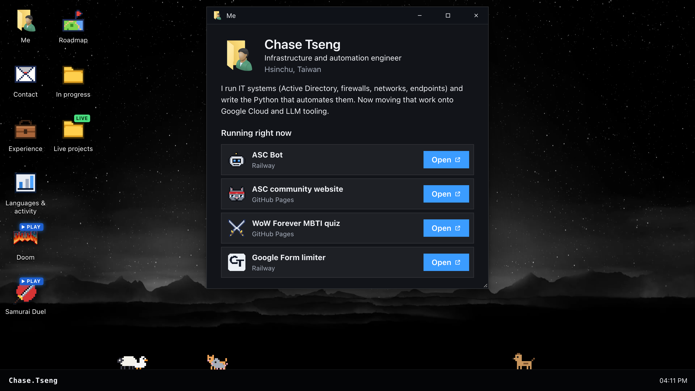

### Hi, I’m Chase

> Infrastructure and automation engineer in Hsinchu, Taiwan. I run IT systems and write the Python that automates them.
> Everything I’m working on lives on my desktop at **[chase5ws.github.io/chase5ws](https://chase5ws.github.io/chase5ws/)**: open the **Live** folder to try the running sites.

**Public sites**: open them and try the demo
<!-- repos:start -->

- **[ASC community website](https://github.com/chase5ws/2026_asc_web3_website)**, NFT mint, outfits and market plus a token vault on Polygon, in Chinese and English ([live](https://chase5ws.github.io/2026_asc_web3_website/)) <!--c--> · Public · [`060fc63`](https://github.com/chase5ws/2026_asc_web3_website/commit/060fc63f8a3467886c63446954770ce3f5f5179c) · 2026-11-12 16:02
- **[Google Form limiter](https://github.com/chase5ws/2026_google_form_limiter)**, caps sign-ups on Google Forms for many organisations and emails the waitlist ([live](https://2026googleformlimiter-production.up.railway.app)) <!--c--> · Public · [`71bb447`](https://github.com/chase5ws/2026_google_form_limiter/commit/71bb4472b45f8f4c5a9f9a769ef57c891554a37d) · 2026-11-12 16:02
- **[WoW Forever MBTI quiz](https://github.com/chase5ws/2026_wow_forever_mbti)**, twenty story questions that pick a race and class ([live](https://chase5ws.github.io/2026_wow_forever_mbti/)) <!--c--> · Public · [`be89ac4`](https://github.com/chase5ws/2026_wow_forever_mbti/commit/be89ac4d4300a8672ab96e1d8ba1003346e13429) · 2026-11-11 12:45
- **ASC Bot**, a Discord bot that communities license per server, with plug-in systems and a web admin ([live demo](https://2026ascdiscordbot-production.up.railway.app)) · source is private

**Public projects**

- **[Live Wallpaper new tab](https://github.com/chase5ws/2026_google_wallpaper_customized)**, a Chrome extension for animated wallpapers and draggable widgets <!--c--> · Public · [`c930c7d`](https://github.com/chase5ws/2026_google_wallpaper_customized/commit/c930c7d4b5a335844fb70c4d1fcfd13fc8d6ae17) · 2026-11-10 17:23
- **[NFT Whitelist Smart Contract](https://github.com/chase5ws/2024_web3_solidity_asc_smart_contract)**, whitelist minting live on Polygon <!--c--> · Public · [`c3c2243`](https://github.com/chase5ws/2024_web3_solidity_asc_smart_contract/commit/c3c22434e8c27efba7db9b65f2e3f2c8ce61a15b) · 2026-10-25 21:47
- **[RFID Backend Upload Tool](https://github.com/chase5ws/2026_tool_si_fetch-_api_tool)**, Excel to PHP backend sync for production stations <!--c--> · Public · [`ee5bf4d`](https://github.com/chase5ws/2026_tool_si_fetch-_api_tool/commit/ee5bf4daadc51aa84f9178c50bb34bf6ae09854c) · 2026-03-05 09:59
- **[Timesheet Analytics](https://github.com/chase5ws/2026_system_python_work_report_log)**, weighted charts from multi-sheet work logs <!--c--> · Public · [`fbd0006`](https://github.com/chase5ws/2026_system_python_work_report_log/commit/fbd0006c8162b3139511f91cc799e5ff423e3ee3) · 2026-02-24 09:21
- **[Automated Leave Request System](https://github.com/chase5ws/2026_system_python_leave_application_form)**, ready-to-sign Excel leave forms <!--c--> · Public · [`f40a717`](https://github.com/chase5ws/2026_system_python_leave_application_form/commit/f40a717ce4af05e81ccea7577b417b7a3a4f495c) · 2026-02-11 16:10
- **[Trading Signals to Discord](https://github.com/chase5ws/2023_discord_python_auto_api_speaker)**, MACD and RSI strategies with webhook alerts <!--c--> · Public · [`85f08d5`](https://github.com/chase5ws/2023_discord_python_auto_api_speaker/commit/85f08d59f8e6db8490dfeb18d8aee5ea18bc2edc) · 2026-02-11 16:10

**Private projects**

- **claude-easy-mcp**, one MCP server that gives Claude, Codex and Cursor shared project memory, handoffs and skills
- **IT Ops AI Assistant**, a LINE bot that answers IT questions from internal SOPs (building)
<!-- repos:end -->

Currently IT Infrastructure Engineer at Korrnell Hsinchu International Academy; before that, automation and IT for Micron and TSMC suppliers. Open to cloud, DevOps and AI automation roles: [LinkedIn](https://www.linkedin.com/in/chase5ws/) or [email](mailto:contact@chase5ws.com).

Thanks for stopping by.

